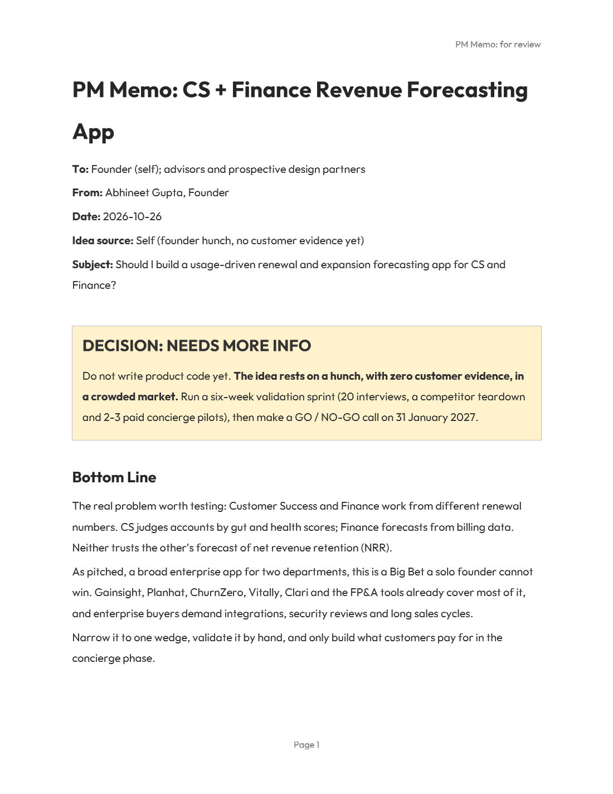

# idea-validator

A Claude Code skill that tells a product manager whether an idea is worth building.

Paste in an idea from sales, the CEO, another PM or yourself. The skill asks for missing context in one batch, scans the competitive landscape, works through eight problem-validation questions and four mental models, scores the idea from 1 to 10, and makes a clear **GO / NO-GO / NEEDS MORE INFO** call. It then writes a formal PM memo as a Word document for review.

## What it does

- **Intake:** problem, users and buyers, evidence, current workaround, business model, builder background, known competitors
- **Competitive scan:** web search for existing tools when the category is established or unknown
- **Eight core questions:** the problem (as a job to be done), its root cause, reach, whether it's a product, how it makes money, possible solutions, trade-offs, and test scenarios and edge cases
- **Mental models:** first principles, systems thinking (Product + Behavior + User + Environment), "I am not the user", inversion / pre-mortem
- **Scoring:** an 8-dimension scorecard, a RICE score out of 10 plus the standard RICE number, a value vs effort quadrant and a Kano category
- **Tone:** directive, active voice, honest pushback with a path to yes
- **PM memo (.docx):** problem statement, affected users, framework scores, risks, alternatives, recommendation, validation plan and next steps. Outfit font in black-grey, 1.5 line spacing, 3 pt before and after each paragraph.

## Example output

Prompt: *"I want to build an enterprise app for finance and customer success teams to drive revenue and retention better."* The skill asked seven intake questions, then delivered:

| | |
|---|---|
| **Decision** | NEEDS MORE INFO |
| **RICE score** | 4.0/10 (classic RICE: 2.2) |
| **Overall** | 3.5/10. Impact is real, but confidence is 2/10 (a founder hunch) and effort is 8/10 |
| **Quadrant** | Big bet |
| **Call** | Don't write code yet. Narrow to one wedge, run 20 interviews and 2-3 paid concierge pilots, decide on a fixed date. |

<p align="center">
  
</p>

📄 [Read the full example memo (PDF)](examples/example-memo-cs-finance-forecast.pdf)

## Install

```bash
git clone https://github.com/PyDaft/idea-validator-skill.git ~/.claude/skills/idea-validator
cd ~/.claude/skills/idea-validator/scripts && npm install
```

Requires Node.js 18+ for the memo. Install the [Outfit font](https://fonts.google.com/specimen/Outfit) so the memo renders as intended.

## Use

In Claude Code, describe an idea and ask whether to build it, or run `/idea-validator <idea>`.

## Files

| Path | Purpose |
|---|---|
| `SKILL.md` | The skill's instructions |
| `references/scoring-rubric.md` | Score anchors, the RICE formulas and the value vs effort quadrant |
| `references/memo-template.md` | The memo's fields and writing rules |
| `scripts/build_memo.js` | Builds the formatted .docx from JSON |
| `evals/evals.json` | Test prompts |

## License

MIT. See [LICENSE](LICENSE).
